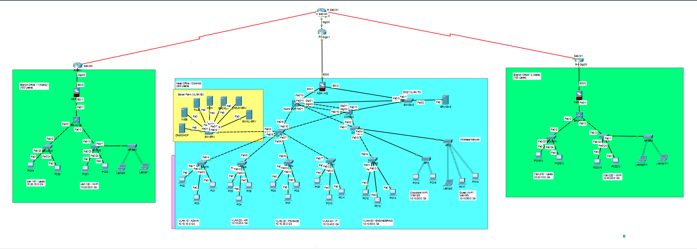

# Enterprise Multi-Branch Network Design, Implementation & Security

**Status:** In Progress  
**Platform:** Cisco Packet Tracer  
**Sites:** Colombo Head Office, Kandy Branch and Galle Branch

## Project Overview

This project focuses on designing, implementing and documenting a multi-branch enterprise network using Cisco Packet Tracer. The design represents a central head office in Colombo connected to branch offices in Kandy and Galle through WAN links.

The network is organized using a hierarchical approach and includes wired and wireless user networks, server infrastructure, VLAN segmentation and security-oriented network controls. The topology and Packet Tracer file in this repository represent the current working version and may change as implementation continues.

## Current Network Layout

- **Colombo Head Office:** Central site with core/distribution connectivity, user VLANs, server network, DMZ and wireless network segments.
- **Kandy Branch:** Branch network with separate user and Wi-Fi segments.
- **Galle Branch:** Branch network with separate user and Wi-Fi segments.
- **WAN:** Inter-site connectivity linking the three locations.



## Technologies and Concepts

The project is being developed around the following networking concepts. The implementation status of each feature should be verified against the latest Packet Tracer file and evidence before describing it as completed:

- Cisco Packet Tracer network simulation
- Hierarchical network design
- VLAN segmentation and IP addressing
- Inter-VLAN routing
- Trunk links and WAN connectivity
- Spanning Tree Protocol (Rapid PVST+)
- PortFast and BPDU Guard
- EtherChannel / link aggregation
- First-hop redundancy and routing
- DHCP and network services
- Network access and security controls
- Network troubleshooting and connectivity testing

## Repository Structure

```text
Enterprise-Multi-Branch-Network-Design/
├── README.md
├── Packet-Tracer/
│   └── Enterprise-Multi-Branch-Network-Stage-10-WAN-Current.pkt
├── Network-Topology/
│   └── Current-Network-Topology.png
├── Documentation/
│   ├── Project-Overview.md
│   └── Implementation-Log.md
├── Configurations/
│   ├── Core-Switches/
│   ├── Distribution-Switches/
│   ├── Access-Switches/
│   └── Routers/
└── Screenshots/
```

## Current Project Status

This is an active, evolving project. The uploaded Packet Tracer file is the current working snapshot at the WAN implementation stage. Device configurations, topology, screenshots and documentation will be updated as further stages are completed and tested.

Do not assume that every technology listed above is already fully implemented. Refer to the implementation log and the latest project evidence for the current status.

## How to Open the Project

1. Install or open Cisco Packet Tracer.
2. Download the latest `.pkt` file from the `Packet-Tracer` folder.
3. Open the file in Cisco Packet Tracer.
4. Review the topology and device configurations.

## Author

**Lakshitha Walakuluarachchi**  
BICT (Hons) Undergraduate – Network Technology  
University of Sri Jayewardenepura, Sri Lanka

- GitHub: https://github.com/WalakuluArachchiLakshitha
- LinkedIn: https://www.linkedin.com/in/lakshitha-w-arachchi

---

*This repository is maintained as a project portfolio. The Packet Tracer simulation and supporting documentation are updated as the project develops.*
